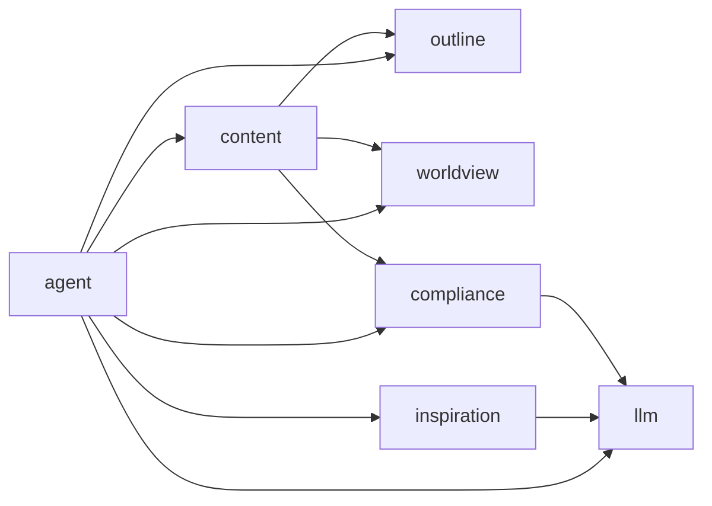

# 架构总览

InkLore 采用模块化单体：Go API、后台 Worker 和七个业务域共用同一仓库；Creator Studio 与 Admin Console 是物理隔离的两个 React 应用。

## 业务依赖方向

图表示 ADR-0016 允许的领域依赖方向，不意味着可以跨域直接访问表或基础设施。跨域通信需走 Port，compliance 对 content 的暴露只允许只读审阅。

## 唯一权威

- [AGENTS.md：七领域与工程红线](https://github.com/BaSui01/InkLore/blob/dev/AGENTS.md)
- [R1 设计基线](https://github.com/BaSui01/InkLore/blob/dev/docs/system-design/00-CONTRACT-BASELINE.md)
- [架构实施事实](https://github.com/BaSui01/InkLore/blob/dev/docs/architecture.md)

更多细节见 [system-design 设计索引](https://github.com/BaSui01/InkLore/blob/dev/docs/system-design/00-INDEX.md)。
